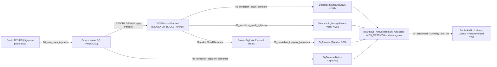

# Lakehouse Compute Benchmark on Google Cloud

A reproducible, apples-to-apples Medallion (Bronze -> Silver -> Gold) compute and storage benchmark comparing three execution engines on Google Cloud using TPC-DS:

1. **Dataproc on GCE — Standard Spark** (`--engine=default`, Spark 3.5 JVM / `WholeStageCodegen`) over open GCS Snappy Parquet
2. **Dataproc on GCE — Lightning Engine** (`--engine=lightning`):
   - **Base Lightning** (`spark.dataproc.lightningEngine.runtime=default`)
   - **Lightning + Gluten/Velox C++ NQE** (`spark.dataproc.lightningEngine.runtime=native`)
3. **BigQuery DataFrames (`BigFrames 2.x`)** (`bigframes.pandas` with `ordering_mode="partial"`) over:
   - **BigLake External Parquet (`bigframes_biglake_gcs`)** — querying the exact same GCS Parquet files read by Spark
   - **Native BigQuery Capacitor (`bigframes_native_bq`)** — querying clustered native tables with `storage_billing_model='PHYSICAL'`

---

## Benchmark Goals & Fairness Guardrails

Every design choice in this repository isolates **Compute Engine throughput** from **Storage Format efficiency**:

1. **Zero BigQuery Pushdown on Spark (`01` & `02`):** Neither Spark notebook nor the shared PySpark runner uses `spark-bigquery-connector`. All Spark reads and Silver/Gold writes operate strictly on open Parquet files in Cloud Storage (`gs://${BENCH_BUCKET}/...`).
2. **Identical x86 Hardware Parity on Dataproc (`2.3-debian12`):** Both `CLUSTER_STD_NAME` (`--engine=default`) and `CLUSTER_LGT_NAME` (`--engine=lightning`) use identical x86 GCE machine types (`n2d-standard-4` master, `n2d-standard-8` primary workers, NVMe Local SSDs, `--no-address`, Private Google Access, Shielded Secure Boot).
3. **Fair `BigFrames 2.x` & Slot Governance (`03`):**
   - Uses official `bigframes.pandas as bpd` (`>=2.40.0`) with `bpd.options.bigquery.ordering_mode = "partial"` for distributed SQL pushdown without unnecessary global ordering hashes.
   - Evaluates both `biglake_gcs_parquet` (same GCS bytes as Spark) and `bq_native_capacitor` (`PHYSICAL` storage billing).
   - Executes inside a capped BigQuery Enterprise Edition autoscale reservation (`BQ_SLOT_CAP`, default `100` slots) and inspects `INFORMATION_SCHEMA.JOBS_BY_PROJECT` for exact `total_slot_ms` and `total_bytes_processed`.
4. **Intra-US Zero-Egress Topology:** BigQuery datasets (`US`), GCS bucket (`US`), and Dataproc GCE clusters (`us-central1`) stay intra-US for `$0.00` GCS data-transfer egress.
5. **Zero-Code Scale Portability:** Switch `SCALE_PRESET` in `.env` (`small_1g` -> `medium_100g` -> `large_500g`) and re-run `00_data_copy_ingestion.ipynb` only; notebooks `01`–`04` execute unchanged.

---

## Architecture Overview



```text
+----------------------------------------------------------------------------------+
|                       US Multi-Region Zero-Egress Data Plane                     |
|                                                                                  |
|  [00_data_copy_ingestion.ipynb]                                                  |
|     bigquery-public-data.tpc_ds_{1g,10t}                                         |
|        ├──> DS_BRONZE_NATIVE (Capacitor, PHYSICAL billing, CLUSTER BY *_sk)      |
|        └──> gs://BENCH_BUCKET/bronze/<SCALE_PRESET>/<table>/*.parquet (Snappy)   |
|                └──> DS_BRONZE_BIGLAKE (External Tables via BigLake Connection)   |
+----------------------------------------------------------------------------------+
         |                                      |                         |
         v (GCS Parquet only)                   v (GCS Parquet only)      v (BigFrames 2.x)
  [01 Spark Standard]                    [02 Spark Lightning]      [03 BigFrames BQ]
  Dataproc --engine=default              Dataproc --engine=lightning  BigLake + Native
  (JVM WholeStageCodegen)                (Base + Velox C++ NQE)       (100-slot Enterprise)
         \                                      |                         /
          +------------------------+------------+------------------------+
                                   v
            [21-Field Telemetry: results/live_runs/benchmark_runs.jsonl]
                                   v
            [04_benchmark_summary_and_tco.ipynb] (Parity + Speedup + TCO)
```

---

## Medallion Benchmark Specification

All engines execute the exact same 4 pipeline stages (defined in [SPEC.md](SPEC.md)):

| Stage ID | Name | Workload Pattern & Key Operations |
| :--- | :--- | :--- |
| `stage1_bronze_to_silver` | Omnichannel Sales & Returns Reconciliation | Clean sales filter (`sold_date_sk`, `item_sk`, `customer_sk` non-null; `quantity > 0`), pre-aggregate `store_returns` & `web_returns` by `(item_sk, ticket/order_number)` to prevent join fan-out, left-join sales to returns, `UNION ALL` (`STORE` + `WEB`), materialize 15-column `silver_omnichannel_sales`. |
| `stage2a_silver_vectorized` | Vectorized Tiering & Margin Scoring | Compute 4-tier `order_risk_tier` (`HIGH_RETURN_RISK`, `VIP_FULL_PRICE`, `PROMO_DRIVEN`, `STANDARD`) and `adjusted_margin_score` (`ROUND(..., 4)`) using native vectorized Catalyst/Velox `F.when` or `BigFrames` boolean expressions; materialize `silver_enriched_sales`. |
| `stage2b_silver_udf` | Scalar Python UDF / Fallback Contrast | Execute identical 4-branch Python scoring logic (`100%` rows on `small_1g`; deterministic `(order_number % 20) == 0` 5% sample on `100g`/`500g`). Captures Velox-to-JVM `BatchEvalPythonExec` fallback on Spark NQE vs. SQL pushdown in BigFrames. |
| `stage3_silver_to_gold` | 5-Way Star Join + Rolling Windows + Exact Distincts | Join `silver_enriched_sales` with `customer`, `customer_demographics` (`COALESCE(s.cdemo_sk, c.c_current_cdemo_sk)`), `item`, and `date_dim`; aggregate to daily grain (`COUNT(*)`, `COUNT(DISTINCT customer_sk)`, revenue/return sums, avg score); compute `rolling_7d_net_paid`, `rolling_30d_net_paid`, `rolling_30d_return_rate`, and `category_daily_share`; materialize `gold_omnichannel_kpi_mart`. |

**Cross-Engine Correctness Gate:** Across all 5 `engine_variant`s, `output_row_count` (`COUNT(*)`) must match **100%** and `checksum_net_paid` (`ROUND(SUM(daily_net_paid), 2)` in Stage 3; `ROUND(SUM(net_paid_after_return), 2)` in Stages 1/2A/2B) must match within **`±0.01%`**.

---

## Scale Presets (`SCALE_PRESET`)

| Preset | Source Dataset | Date / Customer Filter | Target Use Case |
| :--- | :--- | :--- | :--- |
| `small_1g` | `bigquery-public-data.tpc_ds_1g` | Full dataset (`100%` of all 8 tables) | Fast end-to-end validation & CI smoke runs |
| `medium_100g` | `bigquery-public-data.tpc_ds_10t` | Fact `*_date_sk BETWEEN 2452276 AND 2452293` (`18` days in `2002`); `customer` filtered to active `customer_sk` in sliced facts; full `customer_demographics`, `item`, `date_dim` | Mid-scale compute & storage compression comparison (`~100 GB` logical) |
| `large_500g` | `bigquery-public-data.tpc_ds_10t` | Fact `*_date_sk BETWEEN 2452276 AND 2452365` (`90` days in `2002`); `customer` filtered to active `customer_sk` in sliced facts; full `customer_demographics`, `item`, `date_dim` | Sustained multi-minute compute, spill, and autoscale comparison (`~500 GB` logical) |

---

## Repository Layout

```text
.
├── .env.example                             # Environment template (copy to .env; never commit .env)
├── SPEC.md                                  # Authoritative parity, schema, and guardrail contract
├── pyproject.toml                           # uv / Python 3.11+ dependencies
├── scripts/
│   ├── provision_infra.sh                   # Idempotent GCP API, GCS, BigLake, BQ, and Dataproc setup
│   ├── teardown_infra.sh                    # Safe cluster/reservation teardown (--confirm, --purge-data)
│   ├── metrics_helper.py                    # Shared 21-field telemetry logger & .env config resolver
│   ├── run_spark_medallion.py               # Shared PySpark Medallion runner for 01 and 02
│   └── generate_sample_telemetry.py         # Deterministic offline dry-run telemetry generator
├── notebooks/
│   ├── 00_data_copy_ingestion.ipynb         # Bronze TPC-DS ingestion to BQ Native + GCS Parquet + BigLake
│   ├── 01_medallion_spark_standard.ipynb    # Dataproc Standard Spark execution & telemetry
│   ├── 02_medallion_spark_lightning.ipynb   # Dataproc Lightning Base + NQE execution & plan inspection
│   ├── 03_medallion_bigquery_bigframes.ipynb# BigFrames 2.x (BigLake GCS + Native BQ) + slot check
│   └── 04_benchmark_summary_and_tco.ipynb   # Parity audit, performance charts, and TCO calculator
└── results/
    └── sample_benchmark_runs.jsonl          # Tracked synthetic dry-run telemetry for offline testing
```

---

## Quickstart

### 1. Prerequisites
- Google Cloud CLI (`gcloud`) and BigQuery CLI (`bq`) authenticated against your target GCP project
- [`uv`](https://docs.astral.sh/uv/) and Python `>= 3.11`
- Permissions in the target GCP project to enable APIs, manage GCS/BigQuery/BigLake/Dataproc GCE, and create BigQuery Enterprise reservations (or pass `--skip-reservation` if testing without reservation admin quota)

### 2. Configure Environment & Python Dependencies

```bash
cp .env.example .env
# Edit .env and set PROJECT_ID (keep SCALE_PRESET="small_1g" for initial E2E validation)

uv sync
```

### 3. Provision GCP Infrastructure

```bash
./scripts/provision_infra.sh
```

Useful flags:
- `--clusters=both|std|lightning|none` — provision only one Dataproc cluster or skip clusters while testing BigFrames (`default: both`)
- `--skip-reservation` — skip BigQuery Enterprise slot reservation creation/assignment in restricted sandboxes

### 4. Run Notebooks Sequentially (`00` -> `04`)

1. **`notebooks/00_data_copy_ingestion.ipynb`** — Copies the 8 TPC-DS tables into `DS_BRONZE_NATIVE`, exports clean Snappy Parquet shards to `gs://${BENCH_BUCKET}/bronze/${SCALE_PRESET}/`, mounts `DS_BRONZE_BIGLAKE`, and asserts 100% row-count parity.
2. **`notebooks/01_medallion_spark_standard.ipynb`** — Submits `scripts/run_spark_medallion.py` (`--engine-variant=spark_standard`) to `${CLUSTER_STD_NAME}` and logs stage metrics.
3. **`notebooks/02_medallion_spark_lightning.ipynb`** — Runs `spark_lightning_base` (`runtime=default`) and `spark_lightning_nqe` (`runtime=native`) sequentially on `${CLUSTER_LGT_NAME}`, inspects Gluten/Velox vs. JVM fallback plans, and logs stage metrics.
4. **`notebooks/03_medallion_bigquery_bigframes.ipynb`** — Verifies slot reservation governance, executes Stages 1–3 + 2B via `bigframes.pandas` (`ordering_mode="partial"`) against both `DS_BRONZE_BIGLAKE` and `DS_BRONZE_NATIVE`, captures `INFORMATION_SCHEMA.JOBS_BY_PROJECT` slot/byte telemetry, and logs stage metrics.
5. **`notebooks/04_benchmark_summary_and_tco.ipynb`** — Loads `results/live_runs/benchmark_runs.jsonl` (or falls back cleanly to `results/sample_benchmark_runs.jsonl` offline), runs the cross-engine parity audit, renders latency/slot/vCPU charts, and computes parameterized TCO comparisons.

> **Offline Dry-Run:** You can execute `notebooks/04_benchmark_summary_and_tco.ipynb` immediately after `uv sync` with zero GCP resources provisioned—it automatically detects the absence of live logs and renders the full TCO and parity suite from `results/sample_benchmark_runs.jsonl`.

### 5. Tear Down Infrastructure

Stop Dataproc VMs and delete the BigQuery reservation/assignment immediately after benchmarking (preserving datasets and GCS data by default):

```bash
./scripts/teardown_infra.sh --confirm
```

To permanently delete all benchmark datasets, the BigLake connection, and the GCS bucket as well:

```bash
./scripts/teardown_infra.sh --confirm --purge-data
```

---

## TCO & Economic Methodology (`04_benchmark_summary_and_tco.ipynb`)

All unit rates live in a single parameterized configuration cell at the top of `04_benchmark_summary_and_tco.ipynb` (defaulting to `us-central1` GCE/Dataproc and `US` multi-region BigQuery Enterprise Edition list prices):

- **Dataproc GCE Standard:** `(VM vCPU + RAM + $0.010/vCPU-hr Dataproc fee + NVMe Local SSD) * cluster_hours`, toggled across **100% On-Demand**, **15% Primary 1-Yr CUD + 85% Spot EFM**, **1-Yr CUD**, and **3-Yr CUD**.
- **Dataproc Lightning Engine:** Adds the **`+$0.0025 / vCPU-hr`** Lightning Engine surcharge on top of Standard, calculating both the **empirical break-even speedup %** (`~4–10%` on On-Demand VMs, higher on heavy Spot blends) and net cost delta against measured wall-clock speedup.
- **BigQuery Enterprise Edition (`US` multi-region):** Models both:
  - **Shared / Dedicated Slot-Hour Consumption:** `(bq_total_slot_ms / 3,600,000) * slot_rate` (`$0.060` PayGo autoscale list, `$0.048` 1-Yr CUD, `$0.036` 3-Yr CUD), reflecting immediate idle-slot return in shared pools.
  - **Standalone Reservation Ceiling Cost:** `BQ_SLOT_CAP * wall_clock_hours * slot_rate`, documenting BigQuery's 60-second autoscale minimum billing window on sub-minute `small_1g` stages versus sustained `medium_100g`/`large_500g` runs.
- **Compute Equivalency Ratio:** Derives empirical **`1 BigQuery Slot ≈ X Spark vCPUs`** per Medallion stage from measured `vcpu_seconds` and `bq_total_slot_ms`.

---

## License

Apache License 2.0 — see [LICENSE](LICENSE).
