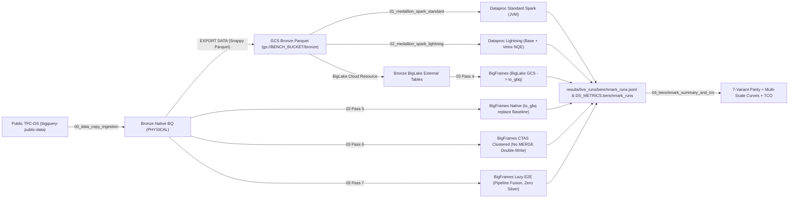

# Lakehouse Compute Benchmark on Google Cloud

A reproducible, apples-to-apples Medallion (Bronze -> Silver -> Gold) compute and storage benchmark comparing three execution engines on Google Cloud using TPC-DS:

1. **Dataproc on GCE — Standard Spark** (`--engine=default`, Spark 3.5 JVM / `WholeStageCodegen`) over open GCS Snappy Parquet
2. **Dataproc on GCE — Lightning Engine** (`--engine=lightning`):
   - **Base Lightning** (`spark.dataproc.lightningEngine.runtime=default`)
   - **Lightning + Gluten/Velox C++ NQE** (`spark.dataproc.lightningEngine.runtime=native`)
3. **BigQuery DataFrames (`BigFrames 2.x`)** (`bigframes.pandas` with `ordering_mode="partial"`) across 4 complementary passes (`BF_PASS_FILTER`):
   - **BigLake External Parquet (`bigframes_biglake_gcs`)** — querying the exact same GCS Parquet files read by Spark
   - **Native Capacitor `to_gbq` Baseline (`bigframes_native_bq`)** — `df.to_gbq(if_exists="replace")` demonstrating staged `_SESSION.bqdf_*` + `MERGE INTO` double-writes and unclustered Silver tables
   - **Native Capacitor Single-Pass Clustered CTAS (`bigframes_ctas_native_bq`)** — within-BigQuery write optimization compiling `df.sql` into `CREATE OR REPLACE TABLE ... CLUSTER BY ...` without `_SESSION + MERGE` overhead or `daily.cache()` (preserving all 4 Silver/Gold checkpoints)
   - **Cloud-Native Lazy End-to-End Fusion (`bigframes_lazy_e2e_bq`, `stage_e2e_bronze_to_gold`)** — **pipeline fusion (no Silver materialization)** compiling Bronze -> Gold in one Dremel CTAS query for Gold parity and TCO contrast

---

## Benchmark Goals & Fairness Guardrails

Every design choice in this repository isolates **Compute Engine throughput** from **Storage Format efficiency**:

1. **Zero BigQuery Pushdown on Spark (`01` & `02`):** Neither Spark notebook nor the shared PySpark runner uses `spark-bigquery-connector`. All Spark reads and Silver/Gold writes operate strictly on open Parquet files in Cloud Storage (`gs://${BENCH_BUCKET}/...`).
2. **Identical x86 Hardware Parity on Dataproc (`2.3-debian12`):** Both `CLUSTER_STD_NAME` (`--engine=default`) and `CLUSTER_LGT_NAME` (`--engine=lightning`) use identical x86 GCE machine types (`n2d-standard-4` master, `n2d-standard-8` primary workers, NVMe Local SSDs, `--no-address`, Private Google Access, Shielded Secure Boot).
3. **Fair `BigFrames 2.x` & Slot Governance (`03`):**
   - Uses official `bigframes.pandas as bpd` (`>=2.40.0`) with `bpd.options.bigquery.ordering_mode = "partial"` for distributed SQL pushdown without unnecessary global ordering hashes.
   - Evaluates both `biglake_gcs_parquet` (same GCS bytes as Spark) and `bq_native_capacitor` (`PHYSICAL` storage billing).
   - Executes inside a capped BigQuery Enterprise Edition autoscale reservation (`BQ_SLOT_CAP`, default `100` slots) and inspects `INFORMATION_SCHEMA.JOBS_BY_PROJECT` for exact `total_slot_ms` and `total_bytes_processed`.
4. **Intra-`US` Zero-Egress or Regional Single-Location Portability:**
   - **Default `US` Multi-Region (`BQ_LOCATION=US`, `GCS_LOCATION=US`, `DATAPROC_REGION=us-central1`):** Keeps BigQuery, GCS, and Dataproc intra-`US` (`$0.00` egress) across all 3 scale presets (`small_1g`, `medium_100g`, `large_500g`) via SQL `CTAS` from `bigquery-public-data.tpc_ds_*`.
   - **Restricted Regional Locations (`BQ_LOCATION != US`, e.g. `asia-southeast1` or `us-central1` under `constraints/gcp.resourceLocations`):** `scripts/stage_tpcds_cross_region.py` streams all 8 `small_1g` tables through the BigQuery Storage Read API (Arrow -> Snappy Parquet) directly into regional GCS and regional BigQuery datasets with **zero `US` datasets or `US` buckets created**. (`medium_100g` and `large_500g` slice `tpc_ds_10t` intra-`US` and fail fast when `BQ_LOCATION != US`.)
5. **Zero-Code Scale Portability:** Switch `SCALE_PRESET` in `.env` (`small_1g` -> `medium_100g` -> `large_500g`) and re-run `00_data_copy_ingestion.ipynb` only; notebooks `01`–`04` execute unchanged.

### Measurement Boundary & Storage Scope Nuances

- **Timer Boundaries (`wall_clock_sec`):**
  - **Dataproc Spark (`01` & `02`):** `scripts/run_spark_medallion.py` executes a `spark.range(1).count()` warm-up first and starts/stops each stage's `wall_clock_sec` timer **in-cluster** around DataFrame construction and `.write.mode("overwrite").parquet(...)`. This excludes `gcloud dataproc jobs submit` CLI startup, YARN application initialization, and executor ramp-up (tracked separately via client-side `submit_wall_clock_sec`).
- **BigQuery DataFrames (`03`):**
  - Each stage's `wall_clock_sec` timer runs **client-side** around `BigFrames` expression compilation and BigQuery materialization, so it includes API submission, SQL query compilation, and job polling round-trips. On sub-second `small_1g` stages, client/API round-trip latency is prominent; on `medium_100g` and `large_500g`, server compute dominates.
  - **`df.to_gbq(replace)` vs. `df.sql` Clustered CTAS vs. Lazy E2E Fusion:** Forensic inspection of `INFORMATION_SCHEMA.JOBS_BY_PROJECT` shows `df.to_gbq(..., if_exists="replace")` (`Pass 5: bigframes_native_bq`) performs two-phase `_SESSION.bqdf_*` staging plus `MERGE INTO dest` double-writes and writes unclustered intermediate Silver tables — burning up to ~59% of total slot-seconds on write staging overhead rather than analytical compute. **`Pass 6 (bigframes_ctas_native_bq)`** eliminates `_SESSION + MERGE` overhead and `daily.cache()` via single-pass `CREATE OR REPLACE TABLE ... CLUSTER BY ...` (`sold_date_sk, customer_sk, item_sk` on Silver; `d_date_sk, channel, i_category` on Gold) while preserving identical 4-stage checkpoints. **`Pass 7 (bigframes_lazy_e2e_bq`, `stage_e2e_bronze_to_gold`)** chains Stages `1 -> 2A -> 3` lazily into one Clustered Gold CTAS with **zero intermediate Silver disk materialization** (explicitly segregated in `04` as **Pipeline Fusion** rather than mixed into 1:1 checkpoint-equivalent Spark slot-to-vCPU ratios).
- **Stage 1 vs. Stages 2A, 2B, and 3 Storage Scope:**
  - **Stage 1 (`stage1_bronze_to_silver`)** is the strict Bronze storage-parity test: Dataproc Spark (`01`, `02`) and `bigframes_biglake_gcs` (`03` Pass 1) scan the exact same Snappy Parquet objects in `gs://${BENCH_BUCKET}/bronze/`, while `bigframes_native_bq` (`03` Pass 2) reads the identical data stored in clustered BigQuery Native Capacitor tables (`storage_billing_model='PHYSICAL'`).
  - **Stages 2A, 2B, and 3** write and read intermediate Silver tables inside each engine's native storage layer: Spark reads/writes Silver Parquet on GCS, whereas **both** `BigFrames` passes (`bigframes_biglake_gcs` and `bigframes_native_bq`) materialize intermediate Silver tables (`silver_omnichannel_sales_*`, `silver_enriched_sales_*`) in native BigQuery `DS_SILVER_BQ` (`PHYSICAL` storage). In Stage 3, `bigframes_biglake_gcs` still reads the 4 Bronze dimension tables from `DS_BRONZE_BIGLAKE` (GCS Parquet), while `bigframes_native_bq` reads them from `DS_BRONZE_NATIVE`.
- **Provisioned vCPU-Seconds vs. Consumed Slot-Seconds:** Spark `vcpu_seconds` measures provisioned worker capacity (`total_worker_vcpus * wall_clock_sec`, including intra-stage skew/idle cores), whereas BigQuery `bq_total_slot_ms` measures actual Dremel slot-milliseconds consumed.

---

## Architecture Overview



```text
+----------------------------------------------------------------------------------+
|                       US Multi-Region Zero-Egress Data Plane                     |
|                                                                                  |
|  [00_data_copy_ingestion.ipynb] (INGEST_MODE=both|native_only)                   |
|     bigquery-public-data.tpc_ds_{1g,10t}                                         |
|        ├──> DS_BRONZE_NATIVE (Capacitor, PHYSICAL billing, CLUSTER BY *_sk)      |
|        └──> gs://BENCH_BUCKET/bronze/<SCALE_PRESET>/<table>/*.parquet (Snappy)   |
|                └──> DS_BRONZE_BIGLAKE (External Tables via BigLake Connection)   |
+----------------------------------------------------------------------------------+
         |                                      |                         |
         v (GCS Parquet only)                   v (GCS Parquet only)      v (BigFrames 2.x, BF_PASS_FILTER)
  [01 Spark Standard]                    [02 Spark Lightning]      [03 BigFrames BQ — Passes 4–7]
  Dataproc --engine=default              Dataproc --engine=lightning  4: BigLake | 5: to_gbq | 6: CTAS | 7: Lazy E2E
  (JVM WholeStageCodegen)                (Base + Velox C++ NQE)       (100 / 200 / 400 Enterprise Slots)
         \                                      |                         /
          +------------------------+------------+------------------------+
                                   v
            [21-Field Telemetry: results/live_runs/benchmark_runs.jsonl]
                                   v
            [04_benchmark_summary_and_tco.ipynb] (7-Variant Parity + 3-Scale TCO)
```

---

## Medallion Benchmark Specification

Staged variants (Passes `1–6`) execute the exact same 4 pipeline stages (`SPEC.md`), while Pass `7` (`bigframes_lazy_e2e_bq`) runs a fused `Bronze -> Gold` pass (`stage_e2e_bronze_to_gold`) skipping intermediate Silver materialization:

| Stage ID | Name | Workload Pattern & Key Operations |
| :--- | :--- | :--- |
| `stage1_bronze_to_silver` | Omnichannel Sales & Returns Reconciliation | Clean sales filter (`sold_date_sk`, `item_sk`, `customer_sk` non-null; `quantity > 0`), pre-aggregate `store_returns` & `web_returns` by `(item_sk, ticket/order_number)` to prevent join fan-out, left-join sales to returns, `UNION ALL` (`STORE` + `WEB`), materialize 15-column `silver_omnichannel_sales` (clustered in Pass 6 by `sold_date_sk, customer_sk, item_sk`). |
| `stage2a_silver_vectorized` | Vectorized Tiering & Margin Scoring | Compute 4-tier `order_risk_tier` (`HIGH_RETURN_RISK`, `VIP_FULL_PRICE`, `PROMO_DRIVEN`, `STANDARD`) and `adjusted_margin_score` (`ROUND(..., 4)`) using native vectorized Catalyst/Velox `F.when` or `BigFrames` boolean expressions; materialize `silver_enriched_sales`. |
| `stage2b_silver_udf` | Scalar Python UDF / SQL Pushdown Contrast | Execute identical 4-branch logic (`100%` rows on `small_1g`; deterministic `(order_number % 20) == 0` 5% sample after full Silver scan on `100g`/`500g`). Captures Velox-to-JVM `BatchEvalPythonExec` fallback on Spark NQE vs. SQL pushdown in BigFrames. |
| `stage3_silver_to_gold` | 5-Way Star Join + Rolling Windows + Exact Distincts | Join `silver_enriched_sales` with `customer`, `customer_demographics` (`COALESCE(s.cdemo_sk, c.c_current_cdemo_sk)`), `item`, and `date_dim`; aggregate to daily grain (`COUNT(*)`, `COUNT(DISTINCT customer_sk)`, revenue/return sums, avg score); compute `rolling_7d_net_paid`, `rolling_30d_net_paid`, `rolling_30d_return_rate`, and `category_daily_share`; materialize `gold_omnichannel_kpi_mart` (clustered in Pass 6 by `d_date_sk, channel, i_category`). |
| `stage_e2e_bronze_to_gold` | Lazy End-to-End Pipeline Fusion (Pass 7 Only) | Lazily composes `stage1 -> stage2a -> stage3` as one `BigFrames` query DAG directly from `DS_BRONZE_NATIVE` and emits Clustered `gold_omnichannel_kpi_mart_lazy_e2e` via single-pass `df.sql` CTAS with **zero intermediate Silver disk writes**. |

**Cross-Engine Correctness Gate:** Across all 6 staged `engine_variant`s (Stages `1`, `2A`, `2B`) and **all 7 variants** on the Final Gold KPI Mart (`stage3_silver_to_gold` + `stage_e2e_bronze_to_gold`), `output_row_count` (`COUNT(*)`) must match **100%** and `checksum_net_paid` must match within **`±0.01%`**.

---

## Scale Presets (`SCALE_PRESET`) & Reference Topologies

| Preset | Source Dataset | Date / Customer Filter | Reference Hardware (`Spark` / `BQ`) |
| :--- | :--- | :--- | :--- |
| `small_1g` | `bigquery-public-data.tpc_ds_1g` | Full dataset (`100%` of all 8 tables) | `16` worker vCPUs (`2 x n2d-standard-8`, `2` NVMe SSDs) / `100` BQ slots |
| `medium_100g` | `bigquery-public-data.tpc_ds_10t` | Fact `*_date_sk BETWEEN 2452276 AND 2452293` (`18` days in `2002`); active `customer_sk`; full dims (`~100 GB` logical) | `64` worker vCPUs (`4 x n2d-standard-16`, `8` NVMe SSDs) / `200` BQ slots |
| `large_500g` | `bigquery-public-data.tpc_ds_10t` | Fact `*_date_sk BETWEEN 2452276 AND 2452365` (`90` days in `2002`); active `customer_sk`; full dims (`~500 GB` logical) | `64` worker vCPUs (`4 x n2d-standard-16`, `8` NVMe SSDs) / `400` BQ slots |

---

## Repository Layout

```text
.
├── .env.example                             # Environment template (copy to .env; never commit .env)
├── SPEC.md                                  # Authoritative parity, schema, and guardrail contract
├── pyproject.toml                           # uv / Python 3.11+ dependencies
├── docs/
│   └── spark-dependency-packaging.md        # Air-gapped (--no-address) Spark Python dependency modes (A/C/D)
├── scripts/
│   ├── provision_infra.sh                   # Idempotent API, GCS, BigLake, BQ, VPC/SA, and Dataproc setup
│   ├── teardown_infra.sh                    # Granular cluster/reservation/data/VPC teardown (--confirm)
│   ├── stage_tpcds_cross_region.py          # Cross-region Storage-Read TPC-DS small_1g ingestion (non-US)
│   ├── metrics_helper.py                    # Shared 21-field telemetry, regional list rates & .env resolver
│   ├── run_spark_medallion.py               # Shared PySpark Medallion runner for 01 and 02
│   ├── generate_sample_telemetry.py         # Deterministic offline dry-run telemetry generator
│   └── check_identifiers.sh                 # Public-repo leak guard against internal/personal identifiers
├── notebooks/
│   ├── 00_data_copy_ingestion.ipynb         # Bronze TPC-DS ingestion to BQ Native + GCS Parquet + BigLake
│   ├── 01_medallion_spark_standard.ipynb    # Dataproc Standard Spark execution & telemetry
│   ├── 02_medallion_spark_lightning.ipynb   # Dataproc Lightning Base + NQE execution & plan inspection
│   ├── 03_medallion_bigquery_bigframes.ipynb# BigFrames 2.x (BigLake GCS + Native BQ) + slot check
│   └── 04_benchmark_summary_and_tco.ipynb   # Parity audit, performance charts, and TCO calculator
└── results/
    └── sample_benchmark_runs.jsonl          # Tracked synthetic dry-run telemetry for offline testing
```

---

## Quickstart

### 1. Prerequisites
- Google Cloud CLI (`gcloud`) and BigQuery CLI (`bq`) authenticated against your target GCP project
- [`uv`](https://docs.astral.sh/uv/) and Python `>= 3.11`
- Permissions in the target GCP project to enable APIs, manage GCS/BigQuery/BigLake/Dataproc GCE, and create BigQuery Enterprise reservations (or pass `--skip-reservation` if testing without reservation admin quota)

### 2. Configure Environment & Python Dependencies

```bash
cp .env.example .env
# Edit .env and set PROJECT_ID (keep SCALE_PRESET="small_1g" for initial E2E validation)

uv sync
```

### 3. Provision GCP Infrastructure

```bash
./scripts/provision_infra.sh
```

`provision_infra.sh` is hardened for enterprise org policies (`skipDefaultNetworkCreation`, `automaticIamGrantsForDefaultServiceAccounts`, `vmExternalIpAccess`, and `resourceLocations`):
- Creates custom VPC `bench-vpc` + Private Google Access subnet `bench-pga-${DATAPROC_REGION}` (`NO Cloud NAT`) and `bench-allow-internal` firewall without ever modifying `default` (unless `--subnet=default` is passed).
- Creates and binds a dedicated least-privilege Dataproc service account (`${DATAPROC_SA_NAME:-bench-dataproc-runner}`) with `roles/dataproc.worker`, bucket `roles/storage.objectAdmin`, and `${DS_METRICS}` `dataViewer`/`dataEditor`.
- Launches clusters with `--no-address`, `--shielded-secure-boot`, `--max-idle=${CLUSTER_MAX_IDLE:-30m}`, and `--max-age=${CLUSTER_MAX_AGE:-4h}`.

Useful flags:
- `--clusters=both|std|lightning|none` — provision one Dataproc cluster, both, or none (`default: both`)
- `--network=<name>` / `--subnet=<name>` / `--create-subnet` — target an existing custom/shared subnet or create one on a custom VPC
- `--reuse-reservation[=<name>]` — verify an existing BigQuery reservation and `QUERY` assignment without modifying or resizing it
- `--skip-reservation` — skip BigQuery Enterprise slot reservation creation/assignment in restricted sandboxes

**Common Enterprise & Companion Sandbox Recipes:**
- **Regional single-region run (e.g. `asia-southeast1`, `small_1g`):** Set `BQ_LOCATION=asia-southeast1`, `GCS_LOCATION=asia-southeast1`, `DATAPROC_REGION=asia-southeast1`, `DATAPROC_ZONE=asia-southeast1-a`, `SCALE_PRESET=small_1g` in `.env`, then run `./scripts/provision_infra.sh` and `00_data_copy_ingestion.ipynb` (which streams `small_1g` cross-region via BigQuery Storage Read API with zero `US` resources created).
- **Low regional vCPU quota (`N2D_CPUS` / `CPUS < 40`, sequential `20`-vCPU mode):** Run `./scripts/provision_infra.sh --clusters=std` -> execute Notebook `01` -> `./scripts/teardown_infra.sh --clusters=std --keep-reservation --confirm` -> `./scripts/provision_infra.sh --clusters=lightning` -> execute Notebook `02`.
- **Reusing an existing sandbox VPC subnet & reservation:**
  `./scripts/provision_infra.sh --subnet=sandbox-pga-asia-southeast1 --reuse-reservation=sandbox-elt-cap`
- **Adding Spark Python dependencies offline (no NAT / `--no-address`):** See [docs/spark-dependency-packaging.md](docs/spark-dependency-packaging.md) for Modes A (Custom Image), C (`--archives` + `venv-pack`), and D (Custom Container running as `spark` UID/GID `1099`).

### 4. Run Notebooks Sequentially (`00` -> `04`)

1. **`notebooks/00_data_copy_ingestion.ipynb`** — In `BQ_LOCATION=US`, copies all 8 TPC-DS tables at `small_1g`, `medium_100g`, or `large_500g` intra-`US` (`$0.00` egress) via SQL `CTAS` + `EXPORT DATA`; in non-`US` regions (`small_1g` only; `100g`/`500g` fail fast), delegates to `scripts/stage_tpcds_cross_region.py` (BigQuery Storage Read API -> regional GCS Parquet -> regional Native `PHYSICAL` + BigLake). Supports `INGEST_MODE=native_only` and asserts 100% row-count parity.
2. **`notebooks/01_medallion_spark_standard.ipynb`** — Submits `scripts/run_spark_medallion.py` (`--engine-variant=spark_standard`) to `${CLUSTER_STD_NAME}` and logs stage metrics.
3. **`notebooks/02_medallion_spark_lightning.ipynb`** — Runs `spark_lightning_base` (`runtime=default`) and `spark_lightning_nqe` (`runtime=native`) sequentially on `${CLUSTER_LGT_NAME}`, inspects Gluten/Velox vs. JVM fallback plans, and logs stage metrics.
4. **`notebooks/03_medallion_bigquery_bigframes.ipynb`** — Verifies slot reservation governance and executes Passes 4–7 (`BF_PASS_FILTER="all"` or comma-separated subset from `biglake,native,ctas_native,lazy_e2e`) via `bigframes.pandas` (`ordering_mode="partial"`), contrasting `to_gbq(replace)` vs. single-pass Clustered CTAS (`df.sql`) vs. Lazy E2E Pipeline Fusion (`stage_e2e_bronze_to_gold`), capturing `INFORMATION_SCHEMA.JOBS_BY_PROJECT` slot/byte telemetry.
5. **`notebooks/04_benchmark_summary_and_tco.ipynb`** — Loads `results/live_runs/benchmark_runs.jsonl` (or falls back cleanly to `results/sample_benchmark_runs.jsonl` offline), runs the 7-variant Gold/stage parity audit, renders 3-scale latency/equivalency/cost scaling curves, separates 1:1 checkpoint-equivalent engines from Pass 7 Pipeline Fusion, and computes regionalized TCO comparisons (`get_list_rates`).

> **Offline Dry-Run:** You can execute `notebooks/04_benchmark_summary_and_tco.ipynb` immediately after `uv sync` with zero GCP resources provisioned—it automatically detects the absence of live logs and renders the full 7-variant, 3-scale TCO and parity suite from `results/sample_benchmark_runs.jsonl`.

### 5. Tear Down Infrastructure

Stop Dataproc VMs and delete the benchmark BigQuery reservation/assignment immediately after benchmarking (preserving datasets, GCS data, and external reservations such as `sandbox-elt-cap` by default):

```bash
./scripts/teardown_infra.sh --confirm
```

Granular / sequential-mode options:
- `--clusters=both|std|lightning|none` — delete only one cluster (useful between Notebooks `01` and `02` in sequential 20-vCPU mode) or skip cluster deletion
- `--keep-reservation` — preserve the BigQuery reservation and `QUERY` assignment (always preserves foreign/shared `sandbox-elt-cap` unless `--force-delete-reservation` is passed)

To permanently delete all 5 benchmark datasets, the BigLake connection, `${BENCH_BUCKET}`, Dataproc auto-created `dataproc-temp-*`/`dataproc-staging-*` buckets in `${DATAPROC_REGION}`, and `bench-*` SA/firewall/subnet/VPC resources (`--purge-data` never touches `airport-ops-*` buckets or `sandbox-*` VPC resources; do not run `--purge-data` while Repo A Spark or Spark Connect sessions in `${DATAPROC_REGION}` are actively running):

```bash
./scripts/teardown_infra.sh --confirm --purge-data
```

---

## TCO & Economic Methodology (`04_benchmark_summary_and_tco.ipynb`)

All unit rates come from `scripts.metrics_helper.get_list_rates(...)` (`REGIONAL_LIST_RATES` supporting `US`/`us-central1` and `asia-southeast1`, plus `PRICING_*` env overrides; `US` defaults match `US_LIST_RATES` identically):

- **Dataproc GCE Standard:** `(VM vCPU + RAM + $0.010/vCPU-hr Dataproc fee + NVMe Local SSD) * cluster_hours`, inferring exact per-scale worker & NVMe Local SSD counts (`2` SSDs on `2 x n2d-standard-8` vs. `8` SSDs on `4 x n2d-standard-16`) and toggling across **100% On-Demand**, **15% Primary 1-Yr CUD + 85% Spot EFM**, **1-Yr CUD**, and **3-Yr CUD**.
- **Dataproc Lightning Engine:** Adds the **`+$0.0025 / vCPU-hr`** Lightning Engine surcharge on top of Standard, calculating both the **empirical break-even speedup %** (`~4–10%` on On-Demand VMs, higher on heavy Spot blends) and net cost delta against measured wall-clock speedup.
- **BigQuery Enterprise Edition (`US` multi-region):** Models both:
  - **Shared / Consumed Slot-Hour Consumption:** `(bq_total_slot_ms / 3,600,000) * slot_rate` (`$0.060` PayGo list, `$0.048` 1-Yr CUD, `$0.036` 3-Yr CUD), reflecting immediate idle-slot return in shared pools.
  - **Standalone Reservation Ceiling Cost:** `BQ_SLOT_CAP * wall_clock_hours * slot_rate` (`100` / `200` / `400` slots), distinguishing dedicated `baseline = max` reservations (`0s` warmup, billed wall-clock when unshared) vs. autoscale 60-second min-bill floors.
- **Compute Equivalency Ratio & Optimization Isolation:** Derives empirical **`1 BigQuery Slot ≈ X Spark vCPUs`** strictly on 1:1 checkpoint-equivalent staged variants (`bigframes_biglake_gcs` Stage 1 and staged `bigframes_native_bq` / `bigframes_ctas_native_bq`), while reporting **`bigframes_lazy_e2e_bq`** separately as **Pipeline Fusion (no intermediate Silver materialization)** alongside exact `%` slot-second and TCO reductions vs. `to_gbq(replace)`.

---

## License

Apache License 2.0 — see [LICENSE](LICENSE).
